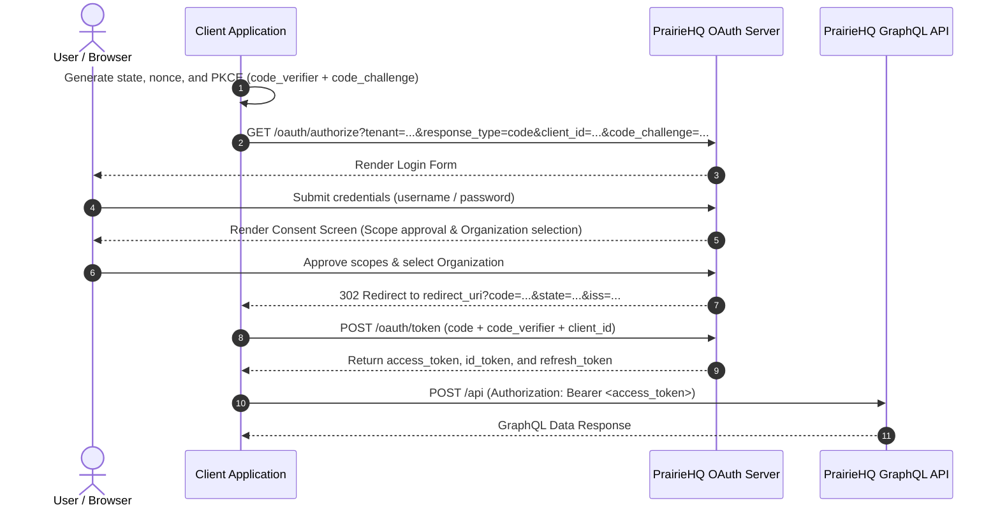

# Authorization Code Flow with PKCE

PrairieHQ mandates the Authorization Code Flow with Proof Key for Code Exchange (**PKCE**, RFC 7636) using the `S256` method for **all** applications.

---

## 1. Sequence Diagram



---

## 2. Step 1: Create PKCE and State Values

Before redirecting the user, your application must generate:
1. `code_verifier`: A cryptographically random, URL-safe string between 43 and 128 characters.
2. `code_challenge`: The Base64URL-encoded SHA-256 hash of the `code_verifier`.
3. `state`: A random string stored in the user's session to prevent Cross-Site Request Forgery (CSRF).
4. `nonce`: (Recommended for OIDC) A random value validated against the issued ID token.

### Code Example (Node.js / Web Crypto)

```javascript
import crypto from 'crypto';

function base64UrlEncode(buffer) {
  return buffer.toString('base64')
    .replace(/\+/g, '-')
    .replace(/\//g, '_')
    .replace(/=+$/, '');
}

const codeVerifier = base64UrlEncode(crypto.randomBytes(32));
const codeChallenge = base64UrlEncode(
  crypto.createHash('sha256').update(codeVerifier).digest()
);
const state = base64UrlEncode(crypto.randomBytes(16));
const nonce = base64UrlEncode(crypto.randomBytes(16));
```

---

## 3. Step 2: Redirect to Authorization Endpoint

Redirect the user's browser to:

```text
GET https://auth.prairiehq.com/oauth/authorize
  ?tenant=<tenant>
  &response_type=code
  &client_id=prairiehq-mobile
  &redirect_uri=https%3A%2F%2Fapp.example.com%2Fcallback
  &scope=openid%20profile%20jobs%20workOrders%20offline_access
  &state=xyzState123
  &nonce=xyzNonce456
  &code_challenge_method=S256
  &code_challenge=E9Melhoa2OwvFrEMTJguCHaoeK1t8URWbuGJSstw-cM
```

### Parameter Reference

| Parameter | Required | Description |
| :--- | :--- | :--- |
| `response_type` | **Yes** | Must be `code`. |
| `client_id` | **Yes** | The client ID provisioned in PrairieHQ. |
| `redirect_uri` | **Yes** | Exact match of one of the client's registered redirect URIs. |
| `scope` | **Yes** | Space-delimited list of requested scopes (e.g. `openid profile jobs`). |
| `code_challenge_method`| **Yes** | Must be `S256`. |
| `code_challenge` | **Yes** | Base64URL(SHA256(code_verifier)). |
| `state` | **Yes** | Cryptographically random state token. |
| `nonce` | Recommended | OIDC nonce passed through to ID token. |
| `tenant` | **Yes** | Tenant identifier for the OAuth client and authorization state. |

---

## 4. Step 3: Handle Callback & Validation

When the user signs in and approves consent, PrairieHQ redirects to your `redirect_uri`:

```text
https://app.example.com/callback?code=bugaboo.a8e945c...&state=xyzState123&iss=https%3A%2F%2Fauth.prairiehq.com
```

### Security Checks on Callback
1. **Validate `state`**: Verify that the returned `state` parameter exactly matches the one stored in your session.
2. **Check for errors**: If the user cancels or denies access, PrairieHQ returns `?error=access_denied&state=...`.
3. **Verify `iss`**: Verify that `iss` matches PrairieHQ's authorization server issuer (`https://auth.prairiehq.com`).

---

## 5. Step 4: Exchange Code for Tokens

Exchange the code via an HTTP `POST` to `/oauth/token`.

### Public Client Request (No Secret)

```http
POST /oauth/token HTTP/1.1
Host: auth.prairiehq.com
Content-Type: application/x-www-form-urlencoded

grant_type=authorization_code
&client_id=prairiehq-mobile
&code=bugaboo.a8e945c...
&redirect_uri=https%3A%2F%2Fapp.example.com%2Fcallback
&code_verifier=original_random_verifier_string_created_in_step_1
```

### Confidential Client Request (With Secret)

Confidential clients authenticate with HTTP Basic header or POST credentials:

```http
POST /oauth/token HTTP/1.1
Host: auth.prairiehq.com
Authorization: Basic <base64(client_id:client_secret)>
Content-Type: application/x-www-form-urlencoded

grant_type=authorization_code
&code=bugaboo.a8e945c...
&redirect_uri=https%3A%2F%2Fapp.example.com%2Fcallback
&code_verifier=original_random_verifier_string_created_in_step_1
```

### Response

```json
{
  "access_token": "eyJhbGciOiJSUzI1NiIs...",
  "token_type": "Bearer",
  "expires_in": 3600,
  "scope": "openid profile jobs workOrders offline_access",
  "id_token": "eyJhbGciOiJSUzI1NiIs...",
  "refresh_token": "bugaboo.9d023b..."
}
```
