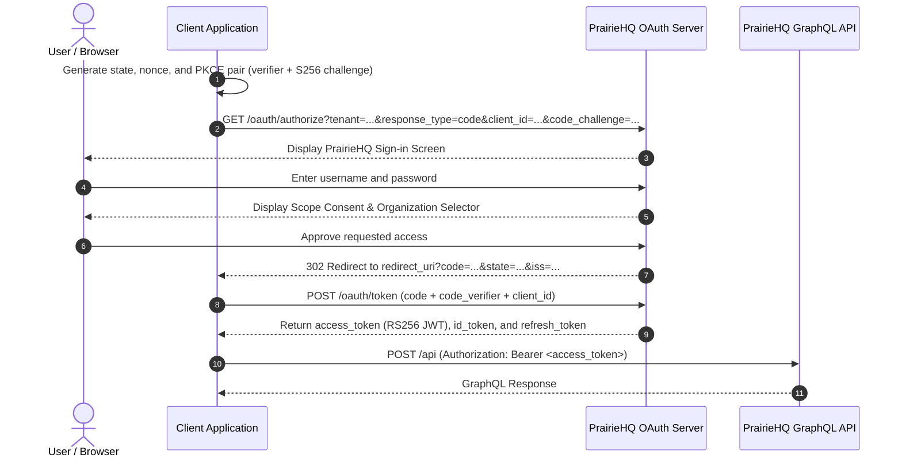

# OAuth 2.0 & OpenID Connect Flow

PrairieHQ provides a standards-compliant **OAuth 2.0 Authorization Server** and **OpenID Connect (OIDC)** provider in `services`. This allows web applications, mobile apps, and third-party partner integrations to securely authenticate users and call the PrairieHQ GraphQL API.

---

## Supported Flow

PrairieHQ enforces **OAuth 2.0 Authorization Code Flow with mandatory PKCE (RFC 7636)** using the `S256` code challenge method.

- **Public Clients**: Single Page Applications (SPAs) and mobile apps that cannot protect a secret must authenticate using PKCE without a client secret.
- **Confidential Clients**: Server-side applications that securely store credentials must authenticate using HTTP Basic or credentials with PKCE.
- **Grant Types Not Supported**: Implicit grant, Resource Owner Password Credentials, and Client Credentials grants are explicitly disallowed for external clients.

---

## Authentication Sequence

---

## OAuth Endpoints

All OAuth and OIDC endpoints below use the canonical issuer
`https://auth.prairiehq.com`. Authorization requests must include the tenant
database key as `tenant=<tenant>`.

| Endpoint | Method | Purpose |
| :--- | :--- | :--- |
| `/.well-known/openid-configuration` | `GET` | OpenID Connect discovery metadata |
| `/.well-known/oauth-authorization-server` | `GET` | RFC 8414 OAuth authorization server metadata |
| `/oauth/jwks` | `GET` | JSON Web Key Set (RS256 public keys for JWT validation) |
| `/oauth/authorize` | `GET`, `POST` | Authorization initiation and consent submission |
| `/oauth/token` | `POST` | Token issuance (`authorization_code` or `refresh_token`) |
| `/oauth/userinfo` | `GET` | Authenticated user profile information |
| `/oauth/revoke` | `POST` | Refresh token revocation |
| `/api` | `POST` | PrairieHQ GraphQL API |

---

## Multi-Tenancy & Data Isolation

PrairieHQ routes OAuth requests within its multi-tenant PostgreSQL architecture:
- **Tenant Prefixing**: Authorization codes and refresh tokens are opaque tokens prefixed with the tenant name (e.g. `bugaboo.<randomToken>`). This allows stateless routing to `phq_<tenant>` without querying the global `phq_app` database.
- **Tenant Selection**: Authorization requests use the canonical auth host and must include `tenant=<tenant>` so PrairieHQ can select the tenant database.
- **Organization Scoping**: During consent, users pick an organization membership. The issued access token is tightly bound to that `organization_guid`.

---

## Token Specifications

### Access Token
- **Format**: Signed RS256 JWT
- **Audience (`aud`)**: `https://api.prairiehq.com`
- **Lifetime**: 1 hour (`3600s`)
- **Usage**: Sent as an HTTP header: `Authorization: Bearer <access_token>` to `POST /api`

### ID Token
- **Format**: Signed RS256 JWT
- **Audience (`aud`)**: The client application's `client_id`
- **Lifetime**: 10 minutes (`600s`)
- **Usage**: Verifies identity and extracts user claims (`sub`, `name`, `email`, `preferred_username`)

### Refresh Token
- **Format**: Opaque token (`<tenant>.<random>`)
- **Lifetime**: 30 days
- **Rotation**: Rotated on every refresh. Presenting a previously consumed refresh token revokes the entire token family immediately (theft detection).

---

## Scopes Reference

### Identity Scopes
- `openid`: Enables OIDC and returns an `id_token`.
- `profile`: Returns the user's full name and username.
- `email`: Returns the user's email address.
- `offline_access`: Issues a 30-day rotating refresh token.

### API Scopes
API scopes map directly to root query and mutation fields in the PrairieHQ GraphQL schema:
- `jobs`: Access to job lists, assignments, completion reports.
- `workOrders`: Access to work orders and contracts.
- `customers`: Access to customer records, properties, and billing profiles.
- `invoices`: Access to invoice creation and payment records.
- `employees`: Access to staff rosters and schedules.

---

## Further Developer Resources

For complete implementation code examples and backend configuration, refer to:
- [`services/oauth2/README.md`](file:///home/boris/code/prairiehq/services/oauth2/README.md)
- [`services/oauth2/AUTHORIZATION_CODE_FLOW.md`](file:///home/boris/code/prairiehq/services/oauth2/AUTHORIZATION_CODE_FLOW.md)
- [`services/oauth2/TOKENS_AND_SCOPES.md`](file:///home/boris/code/prairiehq/services/oauth2/TOKENS_AND_SCOPES.md)
- [`services/oauth2/CLIENT_EXAMPLES.md`](file:///home/boris/code/prairiehq/services/oauth2/CLIENT_EXAMPLES.md)
