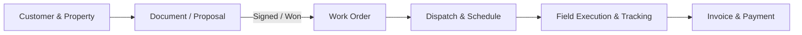

# Getting Started with PrairieHQ

Welcome to PrairieHQ! PrairieHQ is an end-to-end field service management (FSM) platform purpose-built for commercial property maintenance, landscaping, snow removal, and exterior services.

## Overview of the Workflow

PrairieHQ connects the entire lifecycle of field operations from initial quote to final payment:

1. **Customers & Properties**: Maintain accounts, property addresses, billing profiles, and service contacts.
2. **Estimates & Documents**: Draft quotes, proposals, and contracts with line items and service tiers. Clients can review and e-sign online.
3. **Work Orders**: Automatically generate work orders upon proposal approval, defining tasks, billable rates, and job specifications.
4. **Operations & Scheduling**: Assign jobs to crew calendars, optimize routes, and manage recurring vs. on-demand visits.
5. **Field Execution**: Crew leaders clock in, complete checklists, log site visits, and capture condition photos.
6. **Billing & Financials**: Convert completed work orders into invoices, process payments, and track real-time job profitability.

---

## Logging In & First Steps

1. Navigate to your organization's PrairieHQ instance URL (e.g., `https://app.prairiehq.com`).
2. Log in using your email address and password, or use Single Sign-On (SSO / Google / Microsoft) if enabled.
3. When you log in, you will be taken to your organization's default landing view—typically the **Work Schedule** or **Crew List** depending on your assigned role.

---

## Key Terms in PrairieHQ

| Term | Definition |
| :--- | :--- |
| **Organization** | The operating branch or franchise entity within your PrairieHQ account. All records belong to a specific organization. |
| **Customer** | A business, property manager, HOA, or homeowner contracting your services. |
| **Document** | A proposal, estimate, contract agreement, or scope document sent to a client for review and approval. |
| **Work Order** | The operational contract defining specific deliverables, billing rules, budgeted hours, and schedule intervals. |
| **Job** | An individual scheduled visit or crew dispatch associated with a work order. |
| **Site Review** | A visual property inspection, audit, or punch list performed on-site to document grounds conditions. |

---

## Next Steps

- Explore [Navigation & Workspace](/guide/navigation) to learn your way around the sidebar, quick actions, and filters.
- Understand [Roles & Permissions](/guide/roles-and-permissions) to learn what managers, estimators, and crew members can access.
