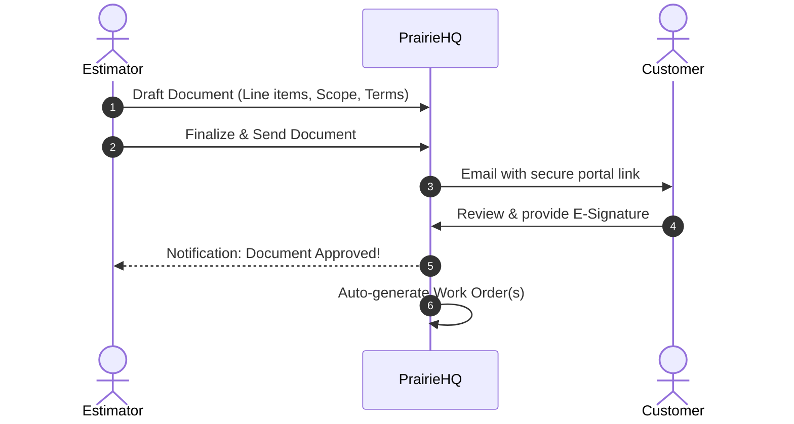

# Documents & Estimates

In PrairieHQ, **Documents** represent proposals, estimates, maintenance contracts, change orders, and seasonal renewals sent to customers.

## Overview

The Documents module allows estimators and sales reps to:
- Build comprehensive quotes using item templates and rate cards.
- Support multi-tier options (e.g., Good / Better / Best packages).
- Send digital links to clients via email or SMS.
- Collect legally binding electronic signatures via the client portal.
- Auto-generate operational Work Orders upon client acceptance.

---

## Document Creation Workflow

### 1. Creating a New Document
1. Navigate to **Workbook → Documents** and click **+ New Document**.
2. Select the **Customer** and target **Property**.
3. Choose a **Document Template** (e.g., "Commercial Grounds Maintenance", "Snow & Ice Management Agreement", "Landscape Enhancement").
4. Define validity terms:
   - **Contract Period**: Start date and expiration/renewal date.
   - **Payment Schedule**: Fixed monthly installment, time & materials, or per-occurrence billing.

### 2. Building Line Items & Scopes
- **Service Categories**: Group items logically (e.g., Spring Clean-up, Weekly Mowing, Turf Fertilization, Irrigation Startup).
- **Pricing Models**:
  - **Flat Fee**: Fixed lump sum for the scope.
  - **Per-Occurrence**: Charge every time the service is delivered (e.g., snow clearing per push).
  - **Hourly / Time & Materials**: Labor hours estimated with material unit allowances.
- **Occurrence Frequency**: Specify expected visit cadence (e.g., 28 weekly visits).

---

## Client Review & Electronic Signatures

When ready:
1. Click **Send to Customer**.
2. PrairieHQ dispatches an email containing a secure personalized link to the [Client Portal](/portal/overview).
3. The customer views your branded proposal, reads terms & conditions, and provides a digital signature directly on their desktop or smartphone.
4. Once signed, the document status transitions to **Approved / Won**, locking the scope and preventing accidental modifications.

---

## Contract Renewals

For recurring annual or seasonal maintenance:
- Use the **Document Renewal** feature under **Workbook → Documents**.
- PrairieHQ highlights contracts approaching expiration.
- In a single batch or individually, clone existing scopes with index adjustments (e.g., 3.5% cost-of-living increase) and queue renewal proposals for the upcoming season.
