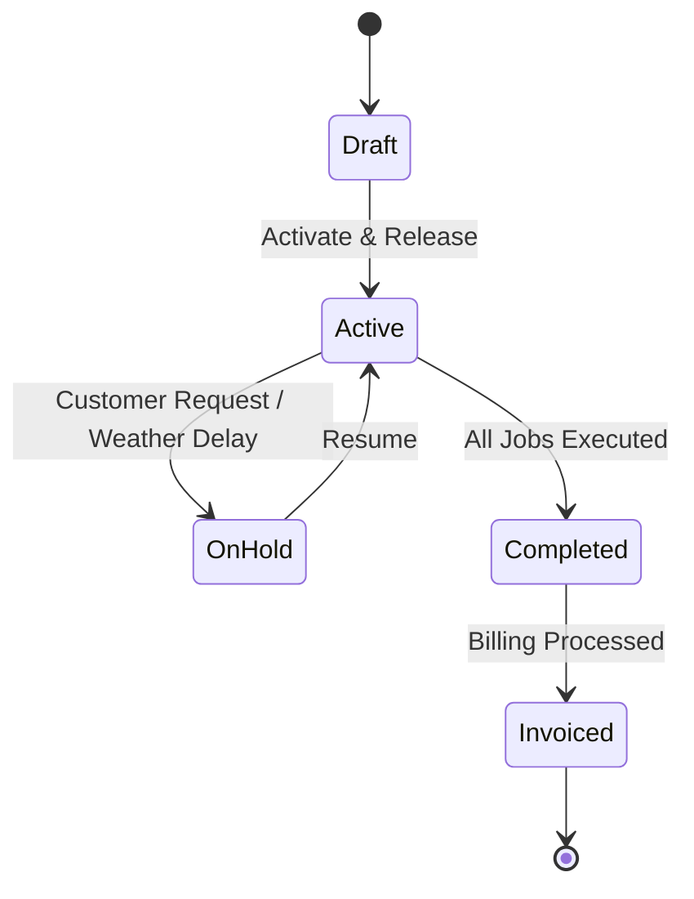

# Work Orders

**Work Orders** are the operational engine of PrairieHQ. They represent the active contract or work package that gets scheduled, dispatched, tracked, and billed.

## Work Order Structure

Every Work Order contains:
- **Customer & Location**: The billing account and physical property coordinates.
- **Scope & Line Items**: Detailed specifications of services, materials, and labor targets.
- **Budgeted Hours & Crews**: Expected person-hours per visit or total project allotment.
- **Billing Configuration**: Progress billing, monthly recurring installment, or per-occurrence trigger.
- **Schedule Rules**: Recurrence cadence (weekly on Tuesdays, bi-weekly, seasonal, or on-demand).

---

## Creating Work Orders

Work orders can be generated in two ways:
1. **From Approved Documents (Recommended)**:
   - When a proposal or estimate is accepted and signed, PrairieHQ provides a prompt to automatically convert the approved scope into one or more Work Orders.
2. **Direct Manual Creation**:
   - Go to **Workbook → Work Orders** and click **+ New Work Order**.
   - Select the customer and property.
   - Enter job title, scope description, budgeted hours, and schedule specifications.

---

## Work Order Status Lifecycle

- **Draft**: Being configured; not yet available on the dispatch board.
- **Active**: Approved for operations; visits will populate on the schedule and crew board.
- **On Hold**: Temporarily paused due to customer request, site condition, or permitting.
- **Completed**: Work has been finished by field crews and verified by management.
- **Invoiced**: Converted to an invoice and billed to the customer account.

---

## Line Items & Cost Occurrences

Work order items define what gets delivered and how performance is measured:
- **Labor Items**: Standard rate per hour, target crew size, and estimated run time.
- **Materials**: Seed, mulch, fertilizer, salt, or plant material with unit rates.
- **Equipment**: Heavy machinery allocations (skid steers, aerators, plows).
- **Subcontractors**: Outside specialty trades or third-party haulers.
